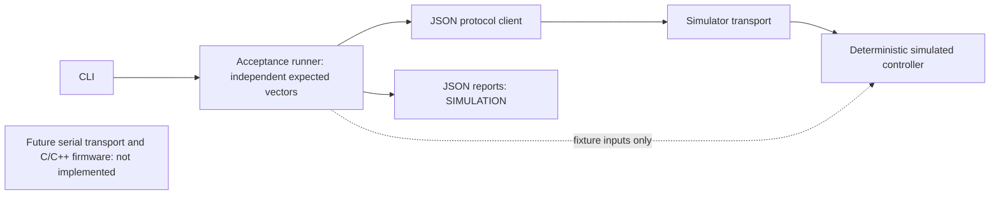

# Embedded Energy Controller & Automated Test Station

**Milestone 1: working software-only prototype. All measurements and demonstration
results are simulated. No physical hardware validation or firmware is implemented.**

A small engineering portfolio project for voltage/temperature fault monitoring and
traceable automated tests. Requirements, provisional units and configuration limits
are in [requirements](docs/requirements.md); the initial USB serial contract is in
[protocol](docs/protocol.md). [Decisions, roadmap, hardware checklist and student
exercise](docs/engineering.md) explain the engineering tradeoffs.



## Setup (Python 3.11 or newer)

Run from the repository root. No runtime dependencies, credentials or services.

```sh
python3 -m venv .venv
source .venv/bin/activate
python -m pip install -e '.[dev]'
python -m pytest
python -m ruff check .
```

On Windows use `py -m venv .venv`, then PowerShell
`.venv\Scripts\Activate.ps1`; the remaining Python commands are the same.

## Demonstrations

```sh
python -m energy_station.cli --scenario normal --report reports/normal.json
python -m energy_station.cli --scenario defective --report reports/defective.json
```

Normal returns exit 0. Defective deliberately returns exit 1: voltage_boundary and
temperature_boundary violate REQ-004 because the mutant fails to assert at equality.
Do not treat that expected demonstration failure as a successful device result.
Both reports label synthetic measurement provenance. Saved actual example runs are
in [examples](examples/); reports/ is ignored for everyday runs. Each case uses a
fresh controller so tests do not depend on previous configuration or fault state.

Reports include UUID run ID, UTC timestamps, identity/firmware version, source Git
revision plus dirty flag, per-test requirement, expected/observed values, reason,
duration, and PASS/FAIL/ERROR totals. Dirty indicates uncommitted source at run time;
null revision means Git provenance was unavailable. Required failures or execution
errors return nonzero. Durations describe host test execution, not device latency.

The simulator advances only on explicit injected samples; telemetry reads do not
advance it. The test suite also exercises malformed/incomplete responses, ID mismatch,
timeouts, atomic config rejection, reset semantics and the intentional mutant.

See the requirement-to-test table in [requirements](docs/requirements.md). Real
serial transport, physical measurements, C/C++ firmware and hardware timing remain
future work; [firmware](firmware/README.md) reserves the interface without claiming implementation.
