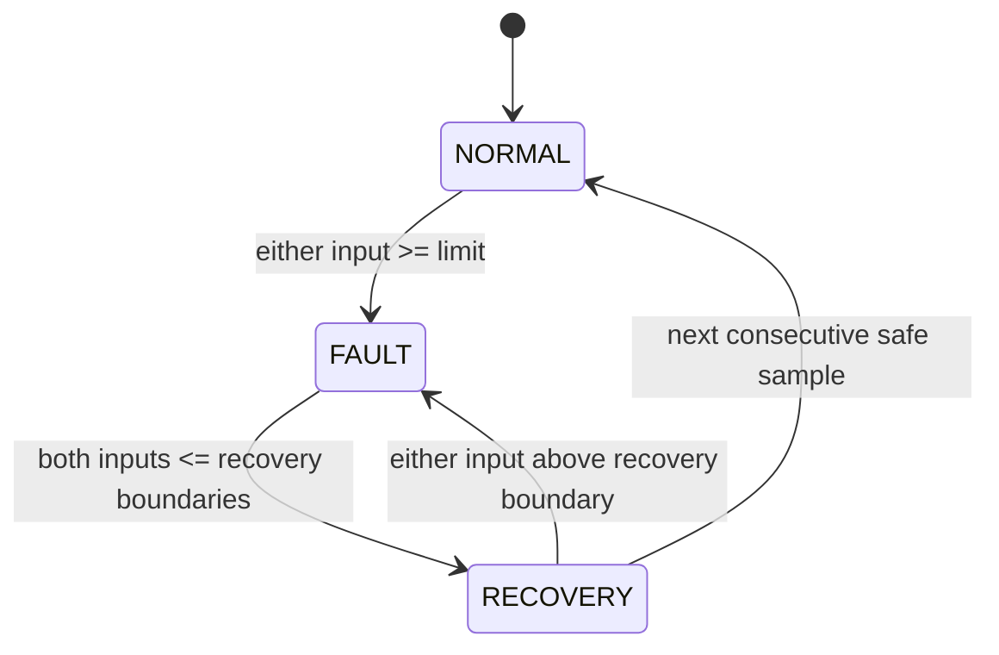

# Requirements — milestone 1

All values below are **provisional simulation parameters**, not hardware ratings or
measurement accuracy claims. No ADC, sensor, board, pinout or sample frequency is selected.
All telemetry and reports in this milestone are synthetic.

| ID | Requirement | Simulation verification | Hardware follow-up |
|---|---|---|---|
| REQ-001 | Identity reports ID, firmware version, protocol version 1 and simulation flag | identity | Real unique identity and flashed firmware provenance |
| REQ-002 | Atomic partial configuration writes; reject invalid values without modification | valid_config, invalid_config_*, test_valid_config_edges | Validate physical operating limits |
| REQ-003 | Telemetry exposes voltage in V, temperature in °C, state and simulation flag | normal_telemetry | Compare against calibrated instruments; determine uncertainty |
| REQ-004 | Any sample at or above either fault limit asserts FAULT | voltage_boundary, temperature_boundary | Timing, noise, sensor and ADC accuracy |
| REQ-005 | Both channels must be at or below their limit minus hysteresis for two consecutive samples; first enters RECOVERY, second NORMAL. Unsafe sample cancels recovery and returns FAULT | hysteresis_recovery, retrip_during_recovery | Select sample period and verify latency |
| REQ-006 | Reset restores defaults, NORMAL, zero recovery counter and synthetic inputs 12 V / 25 °C; configuration is volatile | reset_volatile_config | Define real boot validity handling; never assume physical inputs reset |
| REQ-007 | Bounded JSON lines, correlated IDs, explicit errors and timeout propagation | malformed, incomplete, oversized, wrong_id, wrong_version, bad_envelope, timeout; test_device_errors, test_invalid_frames | USB serial framing, disconnects and real deadlines |
| REQ-008 | Reports contain provenance, UTC times, expected/observed values, duration and PASS/FAIL/ERROR; required failure/error returns nonzero | test_cli_reports, test_transport_exception_is_error | Same reporting with real transport |

## Provisional configuration

| Parameter | Default | Allowed values |
|---|---:|---|
| voltage_limit_v | 15 V | 1–60 V inclusive |
| voltage_hysteresis_v | 1 V | strictly >0 and < voltage limit |
| temperature_limit_c | 60 °C | −20–125 °C inclusive |
| temperature_hysteresis_c | 5 °C | >0–30 °C inclusive, recovery boundary ≥−40 °C |

Only finite JSON numbers are accepted (booleans and strings are rejected).
The ranges describe software validation only: **they do not authorize applying
these voltages or temperatures to hardware**. Overvoltage and overtemperature are
the only faults implemented. Undervoltage, sensor-invalid faults, output control,
watchdogs, real-time guarantees and nonvolatile storage are planned, not implemented.

## Sampling and state semantics

`inject(voltage_v, temperature_c)` supplies one synthetic sample and advances the
state machine once. Reads and configuration writes never advance time or sample count.
New limits take effect at the next sample. Config updates do not clear a fault.
The initial state and synthetic inputs are known at simulator construction; real
firmware must define startup sensor-validity checks separately.

FAULT remains FAULT in the hysteresis band. NORMAL remains NORMAL below fault
limits. A reset uses the explicitly synthetic reset behavior above.
